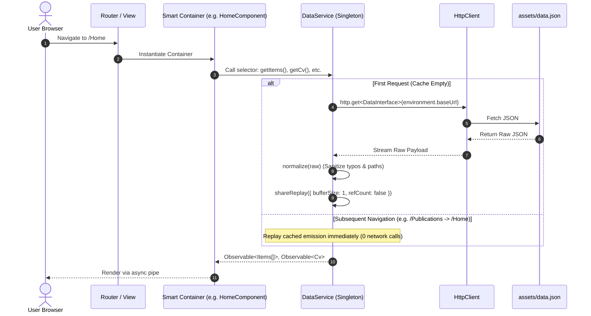

# Technical Audit: API Integration & Data Management

## 1. Data Access Architecture

The application communicates with backend and static assets through Angular's `HttpClient` wrapped inside a dedicated singleton service, [src/app/Services/data.service.ts](file:///Volumes/Project/CV-webpage/src/app/Services/data.service.ts).



---

## 2. Request & Response Lifecycle

### 2.1. Centralized Data Contract (`DataInterface`)
Every network payload is strictly modeled using TypeScript interfaces in [src/app/Model-Interface/cv.model.ts](file:///Volumes/Project/CV-webpage/src/app/Model-Interface/cv.model.ts):

```typescript
export interface DataInterface {
  cv: Cv;
  progress_skill: ProgressSkill[];
  banner: Banner;
  education: Education[];
  about: About;
  publication: Publication;
  social_media: SocialMedia;
}
```

### 2.2. Environment-Based URL Resolution
API target URLs are not hardcoded. They are abstracted into environment configuration files:
- Development: [src/environments/environment.ts](file:///Volumes/Project/CV-webpage/src/environments/environment.ts)
  ```typescript
  export const environment = {
    production: false,
    baseUrl: 'assets/data.json'
  };
  ```
- Production: [src/environments/environment.prod.ts](file:///Volumes/Project/CV-webpage/src/environments/environment.prod.ts)
  ```typescript
  export const environment = {
    production: true,
    baseUrl: 'assets/data.json'
  };
  ```

#### Engineering Rationale (from repository comments):
The `baseUrl` is deliberately specified as a relative path (`assets/data.json`) without leading slashes or `../../` prefixes. This ensures correct asset resolution regardless of deployment root, including GitHub Pages sub-directories (`https://<user>.github.io/<repo>/`).

---

## 3. Data Transformation & Normalization Pipeline

A hallmark of the author's architecture is **defensive data normalization at the service boundary**. The UI components never see raw, malformed, or dirty data.

Inside `DataService`:
```typescript
private normalize(raw: DataInterface): DataInterface {
  if (!raw) {
    return raw;
  }

  // 1. Sanitize image paths
  if (raw.cv) {
    raw.cv.avatar_path = this.assetUrl(raw.cv.avatar_path);
  }

  // 2. Schema typo reconciliation
  const articles = raw.publication?.article;
  if (Array.isArray(articles)) {
    raw.publication.article = articles.map((a: Article) => ({
      ...a,
      // Prefer correctly-spelled key if present, fall back to historical typo
      reference: a.reference ?? a.refrence ?? '',
    }));
  }

  return raw;
}
```

### Path Sanitization Helper:
```typescript
assetUrl(path: string | null | undefined): string {
  if (!path) {
    return '';
  }
  const assetsIdx = path.indexOf('assets/');
  if (assetsIdx >= 0) {
    return path.slice(assetsIdx);
  }
  return path.replace(/^(?:\.\.?\/)+/, '').replace(/^\/+/, '');
}
```

#### Why this is a best-in-class pattern:
1. **Resilience to Upstream Inaccuracies**: If an API or legacy database emits historical typos (e.g. `refrence`), the data service patches it once, freeing templates from complex fallback logic (`item.reference || item.refrence`).
2. **Immutability Protection**: The spread operator `{ ...a, reference: ... }` produces fresh objects without mutating frozen inputs.

---

## 4. Caching & Single-Source-of-Truth

The service employs RxJS `shareReplay` to build an in-memory client-side cache:

```typescript
this.data$ = this.http.get<DataInterface>(environment.baseUrl).pipe(
  map((raw) => this.normalize(raw)),
  shareReplay({ bufferSize: 1, refCount: false }),
);
```

### Configuration Nuances:
- `bufferSize: 1`: Retains exactly the latest emitted payload.
- `refCount: false`: Once the first HTTP request completes, the subscription remains active in memory. When a user switches from `Home` to `About` and back, the HTTP request is **not** re-executed. The cached emission is replayed synchronously.

---

## 5. UI Integration & Loading State Observations

### 5.1. Stream Selection
Presenters query specific slices via selector methods:
```typescript
getCv(): Observable<Cv> {
  return this.data$.pipe(map((d) => d.cv));
}

getItems(): Observable<Items[]> {
  return this.data$.pipe(map((d) => d.cv?.items ?? []));
}
```

### 5.2. Loading Indicator Analysis
The repository contains `src/app/Layout-comp/loader-spiner/loader-spiner.component.ts`. However, it remains a stub template (`<p>loader-spiner works!</p>`) and is not wired to an `HTTP_INTERCEPTOR` or loading state boolean.
- **Audit Observation**: The developer began laying the groundwork for a global loading spinner but relied on the fast response time of local static assets.

---

## 6. API Conventions to Preserve in Future Projects

When building future applications (whether Angular, React, Vue, or backend APIs):
1. **Never let views consume raw API payloads directly**: Always pass responses through a normalization layer at the network edge.
2. **Expose immutable streams / selectors**: UI components should subscribe to fine-grained domain slices (`user$`, `items$`) rather than full monolithic responses.
3. **Use single-flight multicasted caching**: Prevent duplicate network calls for immutable or infrequently changing data.
4. **Environment-agnostic URLs**: Never hardcode protocol, host, or absolute paths in services; resolve all targets via configuration constants.
