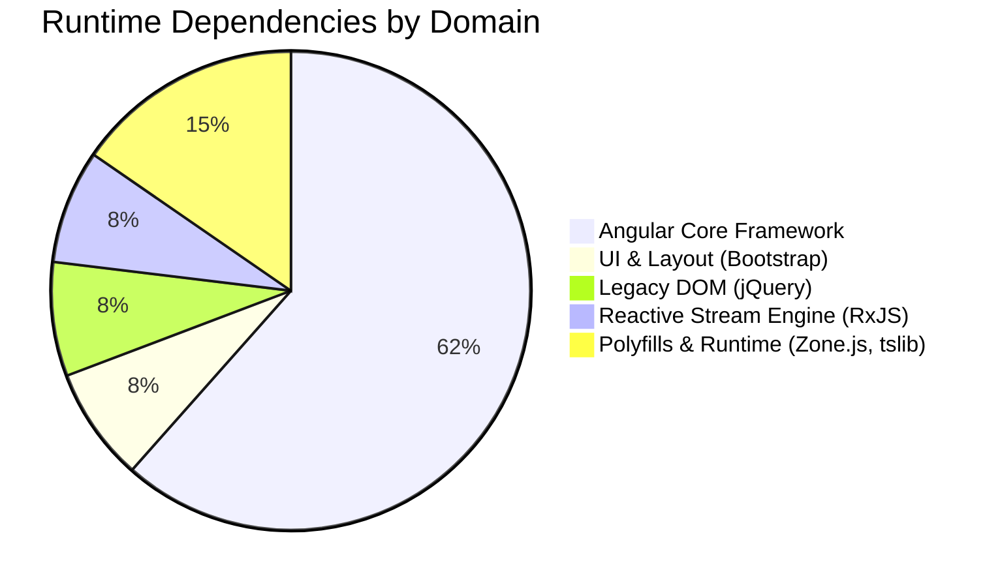

# Technical Audit: Dependencies & Libraries Inventory

## 1. Overview & Categorization

The application manages dependencies using `npm` and tracks them deterministically via [package-lock.json](file:///Volumes/Project/CV-webpage/package-lock.json). The dependency tree is lean, consisting of 11 runtime packages and 10 development packages, centered primarily around the official `@angular` ecosystem.



---

## 2. Runtime Dependencies (`dependencies`)

| Package Name | Installed Version | Purpose in Application | Where Used | Status | Reuse in Future Projects? | Recommended Alternatives |
| :--- | :--- | :--- | :--- | :--- | :--- | :--- |
| **`@angular/core`** | `^14.2.0` | Core framework, DI, component lifecycle, decorators | Throughout `src/app/` | **Essential** | **Yes** (modernize to Angular 18/19) | — |
| **`@angular/common`** | `^14.2.0` | Common directives (`*ngIf`, `*ngFor`), pipes (`async`), `HttpClient` | All modules and templates | **Essential** | **Yes** | — |
| **`@angular/compiler`** | `^14.2.0` | JIT / AOT template compiler | Build & bootstrap pipeline | **Essential** | **Yes** | — |
| **`@angular/platform-browser`** | `^14.2.0` | Browser DOM integration, sanitization | `AppModule`, `main.ts` | **Essential** | **Yes** | — |
| **`@angular/platform-browser-dynamic`** | `^14.2.0` | Dynamic compilation runtime | `main.ts` | **Essential** | **Yes** | — |
| **`@angular/router`** | `^14.2.0` | Client-side routing & lazy-loading | `AppRoutingModule`, Feature routing | **Essential** | **Yes** | — |
| **`@angular/animations`** | `^14.2.0` | Browser animation subsystem | Imported in `package.json` | **Optional** | **Conditional** (only if complex animations needed) | Native CSS transitions / Web Animations API |
| **`@angular/forms`** | `^14.2.0` | Template-driven & reactive forms | Imported in `package.json` | **Optional** (read-only app) | **Conditional** | Reactive Forms (for input forms) |
| **`rxjs`** | `~7.5.0` | Reactive streams, caching (`shareReplay`), transformations (`map`) | `DataService`, container components | **Essential** | **Yes** (Angular 18+ also pairs with Signals) | — |
| **`tslib`** | `^2.3.0` | TypeScript runtime helper functions | Global runtime shim | **Essential** | **Yes** | — |
| **`zone.js`** | `~0.11.4` | Monkey-patches browser async APIs for change detection | `polyfills.ts` | **Essential** (v14) | **Phase Out** (Angular 18+ supports zoneless) | Zoneless change detection |
| **`bootstrap`** | `^5.2.2` | Responsive container grid, navbar, collapse mechanism | `angular.json`, `nav-bar.component.html` | **Semi-Essential** | **Optional** (Bootstrap CSS only, or migrate to Tailwind) | Tailwind CSS, Bootstrap 5 (CSS-only) |
| **`jquery`** | `^3.6.1` | DOM manipulation script included in build scripts | `angular.json` (`scripts[]`) | **Redundant / Obsolete** | **No (Do NOT Reuse)** | Native DOM APIs / Vanilla TypeScript |

---

## 3. Development Dependencies (`devDependencies`)

| Package Name | Installed Version | Role | Essential? | Future Recommendation |
| :--- | :--- | :--- | :--- | :--- |
| **`@angular/cli`** | `~14.2.9` | CLI build, serve, and scaffolding tool | **Essential** | Keep updated with framework version |
| **`@angular-devkit/build-angular`**| `^14.2.9` | Webpack-based Angular build pipeline | **Essential** | Migrate to Vite / `@angular-devkit/build-angular:application` (esbuild) in Angular 17+ |
| **`@angular/compiler-cli`** | `^14.2.0` | Ahead-of-Time (AOT) compiler | **Essential** | Keep matching `@angular/core` |
| **`typescript`** | `~4.7.2` | Static type compiler | **Essential** | Upgrade alongside Angular releases |
| **`jasmine-core`** | `~4.3.0` | BDD testing framework | **Essential** (for current test setup) | Evaluate Jest or Vitest for faster headless execution |
| **`@types/jasmine`** | `~4.0.0` | TypeScript definitions for Jasmine | **Essential** | Retain while using Jasmine |
| **`karma`** | `~6.4.0` | Browser test runner | **Essential** (v14 default) | Karma is deprecated in modern Angular; migrate to Web Test Runner or Jest/Vitest |
| **`karma-chrome-launcher`** | `~3.1.0` | Launches Chrome for Karma tests | **Essential** | Migrate alongside Karma |
| **`karma-coverage`** | `~2.2.0` | Code coverage reporting | **Essential** | Migrate alongside Karma |
| **`karma-jasmine`** | `~5.1.0` | Jasmine adapter for Karma | **Essential** | Migrate alongside Karma |
| **`karma-jasmine-html-reporter`** | `~2.0.0` | HTML UI test runner output | **Optional** | Retain for browser debugging |

---

## 4. In-Depth Dependency Audit Findings

### 4.1. The jQuery Paradox in Modern Angular
`package.json` and `angular.json` bundle jQuery `3.6.1`:
```json
"scripts": [
  "node_modules/bootstrap/dist/js/bootstrap.min.js",
  "node_modules/jquery/dist/jquery.js"
]
```
- **Finding**: Bootstrap 5 completely dropped jQuery as a dependency. The presence of jQuery is a legacy artifact (likely carried over from an earlier Bootstrap 4 boilerplate or tutorial).
- **Impact**: Adds unnecessary bundle weight (~85KB unminified) without being invoked anywhere in the TypeScript codebase.
- **Action for Future Projects**: Completely eliminate `jquery`.

### 4.2. Angular Form & Animation Bundles
- `@angular/forms` and `@angular/animations` are installed in `package.json`, but the application is currently read-only and does not define animated route transitions or complex form inputs.
- **Action**: Keep dependencies strictly aligned with feature consumption.
