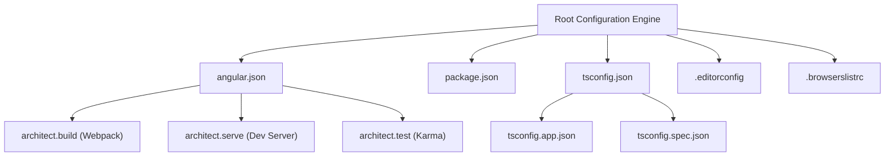

# Technical Audit: Project Configuration & Build Setup

## 1. Configuration Map



---

## 2. Angular CLI Configuration (`angular.json`)

The workspace configuration in [angular.json](file:///Volumes/Project/CV-webpage/angular.json) defines the build targets, assets, style pipelines, and performance budgets.

### 2.1. Project Metadata & Schematics
```json
"projects": {
  "cv-khaki-app": {
    "projectType": "application",
    "schematics": {
      "@schematics/angular:component": {
        "style": "scss"
      }
    },
    "root": "",
    "sourceRoot": "src",
    "prefix": "app"
  }
}
```
- **Default Style Processor**: Enforces `scss` across all newly scaffolded components via Angular CLI schematics.
- **Selector Prefix**: Standard `app-` prefix for all components.

### 2.2. Build Pipeline Options (`architect.build.options`)
```json
"options": {
  "outputPath": "dist/cv-khaki-app",
  "index": "src/index.html",
  "main": "src/main.ts",
  "polyfills": "src/polyfills.ts",
  "tsConfig": "tsconfig.app.json",
  "inlineStyleLanguage": "scss",
  "assets": [
    "src/favicon.ico",
    "src/assets"
  ],
  "styles": [
    "node_modules/bootstrap/dist/css/bootstrap.min.css",
    "src/styles.scss"
  ],
  "scripts": [
    "node_modules/bootstrap/dist/js/bootstrap.min.js",
    "node_modules/jquery/dist/jquery.js"
  ]
}
```

#### Observations:
- **Style Compilation Order**: Bootstrap CSS loads prior to `src/styles.scss`, allowing `styles.scss` and its imported children to override Bootstrap helper classes cleanly.
- **Global Asset Distribution**: The entire `src/assets` folder is copied directly to the root of `dist/cv-khaki-app`, preserving relative URLs for `data.json`, images, and PDFs.

### 2.3. Production vs. Development Optimization Profiles
```json
"configurations": {
  "production": {
    "budgets": [
      {
        "type": "initial",
        "maximumWarning": "500kb",
        "maximumError": "1mb"
      },
      {
        "type": "anyComponentStyle",
        "maximumWarning": "2kb",
        "maximumError": "4kb"
      }
    ],
    "fileReplacements": [
      {
        "replace": "src/environments/environment.ts",
        "with": "src/environments/environment.prod.ts"
      }
    ],
    "outputHashing": "all"
  },
  "development": {
    "buildOptimizer": false,
    "optimization": false,
    "vendorChunk": true,
    "extractLicenses": false,
    "sourceMap": true,
    "namedChunks": true
  }
}
```

- **Output Hashing**: `"all"` ensures cache busting for browser clients upon deployment.
- **Bundle Budgets**: Strict initial bundle limits (`500kb` warning, `1mb` error) ensure performance discipline.
- **Component Style Budget**: `2kb` warning / `4kb` error forces component-level styles to stay minimal, encouraging shared utility classes.

---

## 3. TypeScript Configuration Hierarchy

The project implements a 3-tier TypeScript inheritance tree:

### 3.1. Base Configuration (`tsconfig.json`)
Located at [tsconfig.json](file:///Volumes/Project/CV-webpage/tsconfig.json):
```json
{
  "compileOnSave": false,
  "compilerOptions": {
    "baseUrl": "./",
    "outDir": "./dist/out-tsc",
    "forceConsistentCasingInFileNames": true,
    "strict": true,
    "noImplicitOverride": true,
    "noPropertyAccessFromIndexSignature": true,
    "noImplicitReturns": true,
    "noFallthroughCasesInSwitch": true,
    "sourceMap": true,
    "declaration": false,
    "downlevelIteration": true,
    "experimentalDecorators": true,
    "moduleResolution": "node",
    "importHelpers": true,
    "target": "es2020",
    "module": "es2020",
    "lib": [
      "es2020",
      "dom"
    ]
  },
  "angularCompilerOptions": {
    "enableI18nLegacyMessageIdFormat": false,
    "strictInjectionParameters": true,
    "strictInputAccessModifiers": true,
    "strictTemplates": true
  }
}
```

### 3.2. Application Target (`tsconfig.app.json`)
Extends `tsconfig.json` and restricts compilation scope to application files:
```json
{
  "extends": "./tsconfig.json",
  "compilerOptions": {
    "outDir": "./dist/out-tsc",
    "types": []
  },
  "files": [
    "src/main.ts",
    "src/polyfills.ts"
  ],
  "include": [
    "src/**/*.d.ts"
  ]
}
```

### 3.3. Spec / Test Target (`tsconfig.spec.json`)
Injects Jasmine testing types:
```json
{
  "extends": "./tsconfig.json",
  "compilerOptions": {
    "outDir": "./dist/out-tsc",
    "types": [
      "jasmine"
    ]
  },
  "files": [
    "src/test.ts",
    "src/polyfills.ts"
  ],
  "include": [
    "src/**/*.spec.ts",
    "src/**/*.d.ts"
  ]
}
```

---

## 4. Environment Management

Environment configuration uses Angular's compile-time file replacement pattern:

```text
src/environments/
├── environment.ts        # Loaded during `ng serve` and development builds
└── environment.prod.ts   # Substituted during `ng build --configuration production`
```

Both files declare `baseUrl: 'assets/data.json'`. This separation provides an established pattern for pointing to live staging/production API microservices when transitioning from static JSON to a live backend (e.g. Django/FastAPI).

---

## 5. Code Style & Editor Configuration (`.editorconfig`)

Located at [.editorconfig](file:///Volumes/Project/CV-webpage/.editorconfig):
```ini
root = true

[*]
charset = utf-8
indent_style = space
indent_size = 2
insert_final_newline = true
trim_trailing_whitespace = true

[*.md]
max_line_length = off
trim_trailing_whitespace = false
```

- **Indentation**: Standard 2-space indentation across all file types.
- **Hygiene**: Trims trailing whitespaces and enforces a trailing newline.
- **Markdown Rules**: Disables line length restrictions for readable documentation.

---

## 6. Linter & Formatter Status

- **Status**: No `.eslintrc.json` or `.prettierrc` configuration file is present in the repository.
- **Historical Context**: Angular 14 phased out TSLint. The workspace was generated without the optional `@angular-eslint` schematic.
- **Recommendation**: Integrate ESLint with `@typescript-eslint` and Prettier to automate code formatting and prevent unused variables or untyped `any` parameters.
