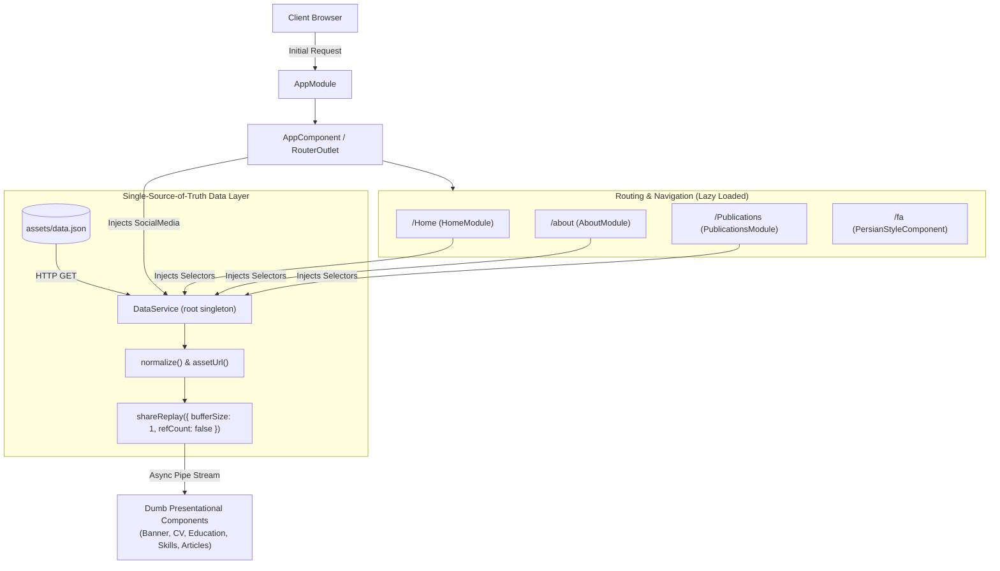

# Technical Audit: Project Overview

## 1. Executive Summary

This document provides a comprehensive architectural overview of the `cv-khaki-app` repository. The application is an interactive, responsive web portfolio and academic Curriculum Vitae (CV) developed using the **Angular** framework. Beyond serving as a standard single-page application (SPA), the codebase features a dual-purpose architecture: an interactive digital portfolio for web browsers and a mathematically calibrated, print-optimized document layout designed to output pixel-perfect physical and PDF resumes.

The application serves as concrete evidence of the developer's software engineering practices, illustrating a distinct evolution from initial exploratory scaffolding toward a sophisticated, reactive, single-source-of-truth architecture.

---

## 2. Core Technical Stack

| Dimension | Technology / Version | Role & Significance |
| :--- | :--- | :--- |
| **Framework** | Angular `14.2.0` | Enterprise SPA framework utilizing NgModule-based feature organization. |
| **Language** | TypeScript `4.7.2` | Strongly typed JavaScript with strict compilation flags enabled. |
| **Reactivity** | RxJS `~7.5.0` | Reactive state propagation using multicasted cached observables (`shareReplay`). |
| **Runtime & CD** | Zone.js `~0.11.4` | Angular change detection coordination. |
| **UI Framework** | Bootstrap `5.2.2` | Base responsive utilities, container structures, and navigation bar. |
| **Styling** | SCSS (Sass) | Custom design token system, CSS Grid utility engine, and `@media print` rules. |
| **DOM Helper** | jQuery `3.6.1` | Auxiliary DOM dependency bundled with legacy Bootstrap scripts. |
| **Testing** | Karma `~6.4.0` / Jasmine `~4.3.0` | Unit test execution and assertion harness. |
| **Companion System** | LaTeX (`pdflatex` / `xelatex`) | Companion academic resume typesetting engine located in `LaTex/`. |

---

## 3. Application Purpose & Use Cases

The application addresses two distinct primary personas and usage profiles:

1. **Digital Web Consumer**:
   - Visitors exploring research interests, publications, academic appointments, technical skills, and photo gallery via client-side routing.
   - Dynamic presentation including navigation bar anchoring, responsive card grids, and interactive links to external profiles (Google Scholar, LinkedIn, GitHub).
2. **Academic & Hiring Committee Reviewer (Print / PDF)**:
   - Evaluators printing or downloading the resume.
   - A dedicated `@media print` stylesheet reformats the screen layout into a clean, black-and-white, Letter/portrait multi-page layout.
   - Irrelevant interactive elements (navbar, interactive toggle buttons, gallery) are stripped, margins are pinned to `0.4in`, base fonts scale to `10pt`, and grid breaks are stabilized.

---

## 4. Key Architectural Patterns

The codebase exhibits several distinct architectural and engineering patterns:

### 4.1. Single-Source-of-Truth with In-Memory Caching (`shareReplay`)
The application eliminates duplicate HTTP requests across routes and child components. A centralized service (`DataService` at [data.service.ts](file:///Volumes/Project/CV-webpage/src/app/Services/data.service.ts)) fetches the master data payload (`assets/data.json`) once and shares the cached emission indefinitely using:
```typescript
this.data$ = this.http.get<DataInterface>(environment.baseUrl).pipe(
  map((raw) => this.normalize(raw)),
  shareReplay({ bufferSize: 1, refCount: false }),
);
```

### 4.2. Smart Container / Dumb Presentational Separation
- **Smart Containers** (`HomeComponent`, `AboutComponent`, `PublicationsComponent`): Responsible for dependency-injecting `DataService`, selecting discrete observable streams, and binding them to the template via the `async` pipe.
- **Dumb Presenters** (`BannerComponent`, `CvComponent`, `EducationComponent`, `ProgressSkillComponent`, `PublicationBoxComponent`): Decoupled UI components that accept inputs via `@Input()` and emit no side-effects.

### 4.3. Defensive Boundary Normalization
Raw external or static JSON data is sanitized at the HTTP intake boundary before reaching components. Typographical inconsistencies in the schema (e.g., historical `refrence` vs `reference`) and relative asset paths (`avatar_path`) are resolved inside `DataService.normalize()`.

### 4.4. Programmatic SCSS Design Token System
Rather than relying on ad-hoc hex codes or generic third-party themes, styles are built on a mathematical SCSS architecture rooted in HSL color coordinates (`hsla(199, 50%, 40%, 100%)`), automated color transformations (`lighten`, `desaturate`, `transparentize`), modular 4px grid spacing, and custom grid utility classes.

### 4.5. Bilingual / RTL Preparedness
The repository contains groundwork for multi-language support (English and Persian / Farsi), evidenced by `src/app/Layout-comp/persian-style/` containing dedicated locale assets (`fa.json`) and route binding (`/fa`).

---

## 5. Architectural Lifecycle & Evolution

An inspection of the repository history (notably commit `df80d81`) reveals a deliberate refactoring phase:
- **Phase 1 (Rapid Prototyping)**: Initial setup used a basic `ApiService` executing uncached HTTP requests, inline hardcoded styles, and loose type definitions.
- **Phase 2 (Architectural Hardening)**: The author refactored the application to introduce reactive caching via `shareReplay(1)`, centralized data sanitization, isolated feature modules, streamlined asset path normalization for GitHub Pages deployments, and comprehensive print-media layout stabilization.

---

## 6. High-Level System Workflow


