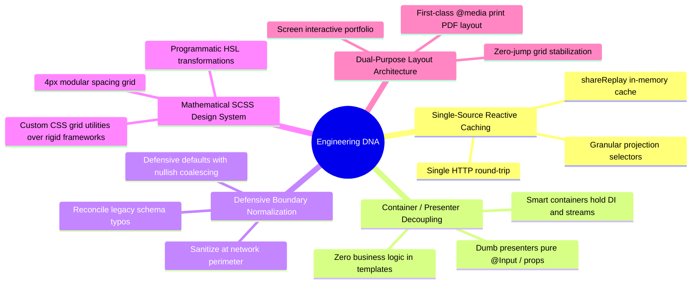

# Reusable Engineering DNA: Personal Development Specification

> **Purpose**: This document serves as the foundational **System Instruction and Engineering Specification** for AI coding agents (such as Claude Code, Codex, and Antigravity) to construct new applications that precisely match the author's architectural philosophy, coding habits, and UI design standards.

---

## 1. Core Engineering Philosophy

The author's development style is characterized by five inviolable pillars:



---

## 2. Universal Architectural Rules (Cross-Framework)

Regardless of the technology stack (Angular, React, Vue, FastAPI, Django), any project following this DNA must adhere to the following contracts:

### Rule 1: The Perimeter Normalization Gate
- **Never allow raw external data to propagate into view layers or core business services**.
- All data entering the application (via HTTP, file read, or external API) must pass through a normalization gate that:
  - Cleans legacy schema discrepancies or typos.
  - Normalizes relative asset paths to prevent deployment breakages.
  - Returns safe, immutable structures with fallback defaults (`[]` for collections, `''` for text).

### Rule 2: Single-Source Replay Caching
- Data that does not change dynamically per user keystroke must be fetched **once** and multicasted to all consumers.
- Subscribing to data from multiple components must never trigger duplicate network requests.

### Rule 3: The Smart/Dumb Component Split
- **Containers**: Manage lifecycle, dependency injection, and state binding.
- **Presenters**: Pure visual renderers. They must not inject global data services or trigger external side effects.

### Rule 4: Algorithmic Design Tokens
- Define a single master brand color (`$base-color` / `primaryColor`) in HSL.
- Derive hover, border, background, and disabled states algorithmically via lightness, saturation, and alpha calculations rather than maintaining dozens of disconnected hex values.

### Rule 5: First-Class Physical Document Printing
- Every web application presenting documents, CVs, invoices, or reports must include a production-ready `@media print` engine.
- Print stylesheets must specify explicit `@page` dimensions, reset backgrounds to clean white, suppress navigation chrome, and stabilize CSS grid columns using `break-inside: auto`.

---

## 3. Technology Translation Matrix

How to translate this engineering DNA into other popular platforms:

### 3.1. Frontend Ecosystems (Angular vs. React vs. Vue)

| Dimension | Angular Standard (Extracted) | React Standard (Equivalent DNA) | Vue 3 Standard (Equivalent DNA) |
| :--- | :--- | :--- | :--- |
| **State / Cache** | `DataService` + `shareReplay(1)` | Custom Hook (`useCvData`) with React Query or Zustand singleton | Pinia Store with action cache / Vue Query |
| **Selectors** | Service methods returning `Observable<T>` (`getItems()`) | Custom selector hooks (`useItems()`, `useCvInfo()`) | Store getters (`store.items`, `store.cvInfo`) |
| **Container Layer** | `HomeComponent` binding streams with `async` pipe | Route Page (`HomePage.tsx`) calling selector hooks | Route View (`HomeView.vue`) using `<script setup>` |
| **Presenter Layer** | Dumb components with strict `@Input()` | Pure functional components with TypeScript `Props` | Components with `defineProps<{ item: Item }>()` |
| **Styling Tokens** | SCSS with `$base-space: 4px` & HSL functions | CSS Modules with CSS Variables or Tailwind with CSS custom properties | SCSS with CSS Variables (`var(--base-color)`) |
| **Print Engine** | `print-size.scss` loaded globally | `print.css` imported in root layout | `print.scss` imported in `App.vue` |

#### React Code Implementation Example:
```typescript
// useCvData.ts - Single-source cache with perimeter normalization
import { useQuery } from '@tanstack/react-query';

interface CvData { ... }

function normalize(raw: any): CvData {
  return {
    ...raw,
    cv: {
      ...raw.cv,
      avatar_path: raw.cv?.avatar_path?.replace(/^(?:\.\.?\/)+/, '') ?? ''
    },
    publication: {
      ...raw.publication,
      article: (raw.publication?.article ?? []).map((a: any) => ({
        ...a,
        reference: a.reference ?? a.refrence ?? ''
      }))
    }
  };
}

export function useCvData() {
  return useQuery({
    queryKey: ['cv-data'],
    queryFn: async () => {
      const res = await fetch('assets/data.json');
      const raw = await res.json();
      return normalize(raw);
    },
    staleTime: Infinity, // Equivalent to refCount: false
  });
}

// Granular selector hooks
export function useCvItems() {
  const { data } = useCvData();
  return data?.cv?.items ?? [];
}
```

---

### 3.2. Backend Frameworks (FastAPI vs. Django)

| Architectural Pattern | FastAPI Implementation | Django / Django REST Framework Implementation |
| :--- | :--- | :--- |
| **Perimeter Normalization** | Pydantic V2 Model with `@model_validator(mode='before')` | DRF `Serializer` with `to_internal_value()` override |
| **Single-Source Caching** | `@lru_cache` on dependency provider function | Django cache framework (`cache.get_or_set()`) |
| **Layered Architecture** | `routers/` -> `services/` -> `schemas/` -> `models/` | `views/` -> `services/` -> `serializers/` -> `models/` |
| **Defensive Fallbacks** | Pydantic `Field(default_factory=list)` | Serializer `serializers.ListField(default=list)` |
| **Response Typing** | Strict Pydantic response models (`response_model=CvSchema`) | DRF ViewSet with explicit `serializer_class` |

#### FastAPI Implementation Example:
```python
# schemas/cv.py - Perimeter normalization matching the author's style
from pydantic import BaseModel, Field, model_validator
from typing import List, Optional

class Article(BaseModel):
    title: str
    reference: str = ""
    journal_link: str
    abstract: str

    @model_validator(mode='before')
    @classmethod
    def reconcile_typos(cls, data: dict) -> dict:
        if isinstance(data, dict):
            # Resolve historical schema typo
            if "reference" not in data and "refrence" in data:
                data["reference"] = data["refrence"]
        return data

class CvSchema(BaseModel):
    name: str
    job_title: str
    avatar_path: str
    items: List[dict] = Field(default_factory=list)

    @model_validator(mode='before')
    @classmethod
    def sanitize_paths(cls, data: dict) -> dict:
        if isinstance(data, dict) and "avatar_path" in data:
            path = data["avatar_path"]
            if path and "assets/" in path:
                data["avatar_path"] = path[path.index("assets/"):]
        return data
```

---

### 3.3. Database Architecture (PostgreSQL)

To reflect the author's data modeling conventions:

1. **Naming Conventions**:
   - Tables: Lowercase plural snake_case (`publications`, `articles`, `education_records`).
   - Primary Keys: Integer or UUID standard (`id BIGSERIAL PRIMARY KEY`).
   - Foreign Keys: Singular entity with `_id` suffix (`publication_id`).
   - Attributes: Snake_case matching JSON contracts (`avatar_path`, `job_title`, `main_title`).

2. **Defensive Schema Design (PostgreSQL DDL)**:
```sql
CREATE TABLE articles (
    id BIGSERIAL PRIMARY KEY,
    publication_id BIGINT NOT NULL REFERENCES publications(id) ON DELETE CASCADE,
    title VARCHAR(512) NOT NULL,
    reference TEXT NOT NULL DEFAULT '',
    journal_link VARCHAR(1024) NOT NULL DEFAULT '',
    abstract TEXT NOT NULL DEFAULT '',
    created_at TIMESTAMPTZ NOT NULL DEFAULT NOW()
);

-- Generated or functional index for clean path resolution
CREATE INDEX idx_articles_pub_id ON articles(publication_id);
```

---

## 4. Prompt Template for AI Coding Agents

When initiating a new project with an AI agent (Claude, Codex, Antigravity), use this prompt template to enforce this exact engineering standard:

```markdown
You are building an application adhering strictly to the "Mohammad Khaki" Engineering Standard:

1. ARCHITECTURAL PATTERN:
   - Enforce the Smart/Container vs. Dumb/Presentational component separation.
   - Container components handle data fetching, state injection, and parameter handling.
   - Presentational components are pure, receive immutable typed properties, and emit events.

2. STATE & DATA ACCESS:
   - Implement single-source-of-truth in-memory caching. Data fetched once must be cached and replayed to all subsequent route or component subscribers (e.g. RxJS shareReplay(1) in Angular, React Query with Infinity staleTime in React, or singleton stores in Vue).
   - Expose granular, typed selector streams/hooks rather than raw monolithic payloads.
   - Sanitize and normalize all incoming data at the service boundary before it reaches the UI (clean typos, normalize asset paths, default empty arrays).

3. STYLING & DESIGN SYSTEM:
   - Use a mathematically derived color palette based on a primary HSL color token.
   - Use a 4px base spacing scale ($base-space: 4px; multiples: 4px, 8px, 12px, 16px, 20px).
   - Build custom CSS Grid utility classes for responsive layouts instead of relying on heavyweight UI frameworks.
   - Provide a dedicated, first-class @media print stylesheet that formats the UI into an ink-friendly, Letter/portrait multi-page layout with stabilized grid columns (break-inside: auto).

4. CODE QUALITY & TYPE SAFETY:
   - Enforce strict typing with zero implicit any.
   - Use nullish coalescing (??) defensively to guarantee safe defaults.
   - Use camelCase for variables/methods, PascalCase for types/components, and snake_case for data payloads originating from backend schemas.
```
