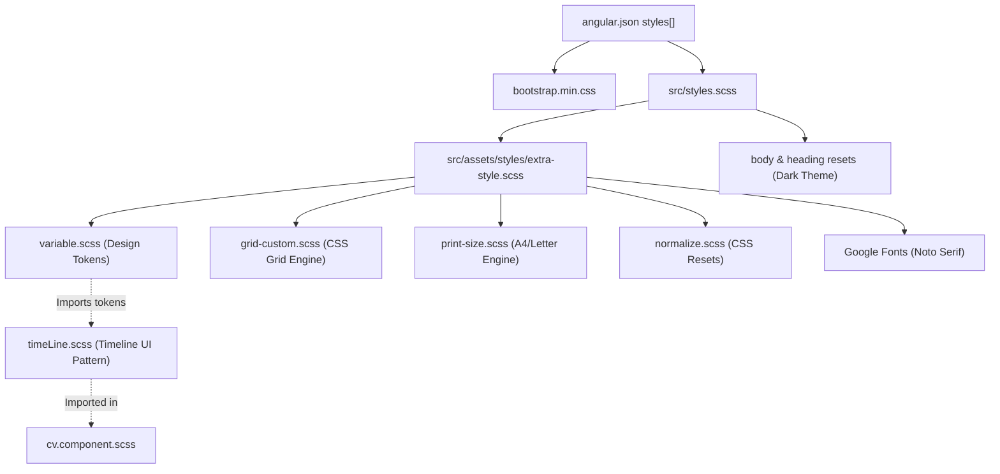

# Technical Audit: SCSS Architecture, Styling & Design System

## 1. Global SCSS Architecture & Dependency Hierarchy

The project implements a bespoke, modular SCSS design system integrated with Bootstrap 5.2.2. The global stylesheet pipeline is declared in [angular.json](file:///Volumes/Project/CV-webpage/angular.json) and compiled through [src/styles.scss](file:///Volumes/Project/CV-webpage/src/styles.scss).



---

## 2. Design Tokens & Color Palette

The color system is defined in [src/assets/styles/variable.scss](file:///Volumes/Project/CV-webpage/src/assets/styles/variable.scss). Instead of relying on static hex codes, the design system utilizes **programmatic HSL color transforms**:

### 2.1. Color Tokens

```scss
// Primary Base Color (Deep Slate / Cerulean Blue)
$base-color: hsla(199, 50%, 40%, 100%); // Equivalent to: #337ab7 / #347ea9

// High-Contrast Text Color (White with 70% opacity)
$base-white: hsla(0, 0%, 100%, 0.70);

// Dominant Dark Theme Background
$background-body: #000000;

// Programmatically Derived Accent Color
$base-color-completed: transparentize(desaturate(lighten($base-color, 30%), 25%), 0.1);
```

### 2.2. Mathematical Analysis of `$base-color-completed`
The accent color `$base-color-completed` illustrates advanced algorithmic color derivation:
1. `lighten($base-color, 30%)`: Raises luminosity from 40% to 70%, creating a pastel cyan/sky tint.
2. `desaturate(..., 25%)`: Reduces saturation from 50% to 25%, softening glare for readability.
3. `transparentize(..., 0.1)`: Drops alpha opacity to 0.9, allowing background textures to show through subtly.

### 2.3. Print Color Palette (Overrides)
In [src/assets/styles/print-size.scss](file:///Volumes/Project/CV-webpage/src/assets/styles/print-size.scss), colors flip for ink conservation and physical readability:
- Background: `#ffffff !important`
- Body Text: `#000000 !important`
- Sub-text / Page numbers: `#555555 !important`
- Headings: `mix(#0b2545, $base-color, 60%) !important` (Sophisticated deep navy-cerulean hybrid)

---

## 3. Spacing System

Spacing is derived from a uniform **4px base grid unit**:

```scss
$base-space: 4px;
```

Multiples of `$base-space` are used consistently across components:
- `1x` ($4px$): Border radius, tight gaps, avatar offsets.
- `2x` ($8px$): Grid gutters (`.g-gap`), list item bottom padding.
- `3x` ($12px$): Horizontal grid gap in sub-timelines.
- `4x` ($16px$): Timeline node left padding (`$base-space * 4`).
- `5x` ($20px$): Timeline circular node dimensions (`height: $base-space * 5; width: $base-space * 5;`).

---

## 4. Typography

The application employs an intentional typographic pairing:

| Context | Font Family | Weight & Style | Sample Usage |
| :--- | :--- | :--- | :--- |
| **Body & UI** | `"Times New Roman", "Segoe UI", Arial, Helvetica, sans-serif` | Normal, `0.96em` | General description, addresses, links |
| **Headings (`h3`, `h5`)** | `"Noto Serif", "Times New Roman", serif` | Bold, Italicized serif | Section headers ("Experience", "Publications") |
| **Print Output** | Strict system serif | `10pt` base (`line-height: 1.3`) | Entire printable resume |

The Google Font import in [src/assets/styles/extra-style.scss](file:///Volumes/Project/CV-webpage/src/assets/styles/extra-style.scss):
```scss
@import url('https://fonts.googleapis.com/css2?family=Noto+Serif:ital,wght@1,700&display=swap');
```

---

## 5. Layout Engine & Custom CSS Grid

The application rejects rigid table structures in favor of lightweight, custom CSS Grid utilities defined in [src/assets/styles/grid-custom.scss](file:///Volumes/Project/CV-webpage/src/assets/styles/grid-custom.scss):

```scss
.g-gap {
  gap: 8px;
}

.g-col-1 {
  grid-template-columns: 1fr;
}

.g-col-1-1 {
  grid-template-columns: 1fr;
}

.g-col-3 {
  grid-template-columns: 1fr 1fr 1fr;
}

.g-col-7-5 {
  grid-template-columns: 1fr;
}

@media only screen and (min-width: 768px) {
  .g-col-1-1 {
    grid-template-columns: 1fr 1fr;
  }
  
  .g-col-7-5 {
    grid-template-columns: 7fr 5fr;
  }
}
```

### Grid Usage:
- `.g-col-1-1`: Split 50/50 dual column layout (e.g. Identity info vs. Contact links on tablet/desktop, stacked on mobile).
- `.g-col-7-5`: Asymmetric column split (7 parts Title/Company, 5 parts Date/Location), automatically collapsing to single column on viewports under 768px.

---

## 6. Signature UI Patterns

### 6.1. The Dashed Timeline Pattern (`timeLine.scss`)
Used in [src/app/Modules/Home/Components/cv/cv.component.html](file:///Volumes/Project/CV-webpage/src/app/Modules/Home/Components/cv/cv.component.html) and defined in [src/assets/styles/timeLine.scss](file:///Volumes/Project/CV-webpage/src/assets/styles/timeLine.scss):

```scss
ul.time-line {
  padding-left: 1.25rem;
  margin-bottom: 0.5rem;

  & > li {
    list-style: none;
    min-height: 50px;
    border-left: 1px dashed $base-color-completed;
    position: relative;
    padding-left: $base-space * 4;
    padding-bottom: $base-space * 2;

    &:last-child {
      border-left: 0;
      padding-bottom: 0;
    }

    &:before {
      position: absolute;
      left: 0px;
      top: 0px;
      transform: translateX(-50%);
      content: " ";
      border: 6px solid $base-color-completed;
      border-radius: 50%;
      background: darken($base-color-completed, 15%);
      height: $base-space * 5;
      width: $base-space * 5;
    }
  }
}
```

#### Key Styling Features:
- Dashed vertical stem using the derived accent color `$base-color-completed`.
- Termination logic (`&:last-child { border-left: 0 }`).
- Geometric node centering via `translateX(-50%)` with a circular multi-layer ring (`border` + `background`).
- Grid-based variant switching: when `isHorizontal()` is triggered, `.horizontal` switches `li` elements into a 2-column or 4-column inline grid without left border stems.

### 6.2. Hero Banner & Viewport Geometry Calculation
In [src/app/Modules/Home/Components/banner/banner.component.ts](file:///Volumes/Project/CV-webpage/src/app/Modules/Home/Components/banner/banner.component.ts), the banner height is calculated dynamically to consume 90% of screen height:
```typescript
setBackgroundSize() {
  this.bannerHeight = window.innerHeight * 0.9;
  return this.bannerHeight + "px";
}
```
And in [src/app/Layout-comp/nav-bar/nav-bar.component.ts](file:///Volumes/Project/CV-webpage/src/app/Layout-comp/nav-bar/nav-bar.component.ts), the navbar is pegged to 10% of window height:
```typescript
setNavSize() {
  this.navHeight = window.innerHeight * 0.1;
  return this.navHeight + "px";
}
```
Combined, these two components form a complete 100vh initial viewport experience.

---

## 7. The Print-Optimization Engine (`print-size.scss`)

One of the most distinctive aspects of the author's engineering style is the dedicated print architecture in [src/assets/styles/print-size.scss](file:///Volumes/Project/CV-webpage/src/assets/styles/print-size.scss).

```scss
@media print {
  // 1. Target exact page geometry
  @page {
    size: letter portrait;
    margin: 0.4in 0.4in 0.4in 0.4in;
  }

  // 2. Scale typography down to physical document dimensions
  html {
    font-size: 10pt !important;
  }

  body {
    background-color: #ffffff !important;
    color: #000000 !important;
    font-size: 10pt !important;
    line-height: 1.3 !important;
  }

  // 3. Prevent page-break anomalies across CSS grids
  .content-bar {
    color: black !important;
    break-inside: auto !important;
    page-break-inside: auto !important;
  }

  .g-col-1-1 {
    display: grid !important;
    grid-template-columns: 1fr 1fr !important;
    gap: 12px !important;
  }

  .g-col-7-5 {
    display: grid !important;
    grid-template-columns: 7fr 3fr !important;
    align-items: center;
  }

  // 4. Selective element suppression
  .hide-sub-in-print {
    display: none !important;
  }

  // 5. High-contrast headings
  .resume h5,
  h3 {
    font-size: 12.5pt !important;
    color: mix(#0b2545, $base-color, 60%) !important;
  }
}
```

### Critical Print Engineering Takeaways:
1. **Defensive Grid Preservation**: Browsers frequently collapse CSS Grids to unstyled blocks during print compilation. The author explicitly forces `display: grid !important` inside `@media print` with explicit fraction columns.
2. **Page-Break Pagination Control**: Utilizing `break-inside: auto !important` ensures list items can span page boundaries cleanly without clipping.
3. **Selective Content Density**: Secondary descriptions (such as detailed bullets under "Research Interests") are tagged with `.hide-sub-in-print` to preserve compact vertical real estate when printing.
